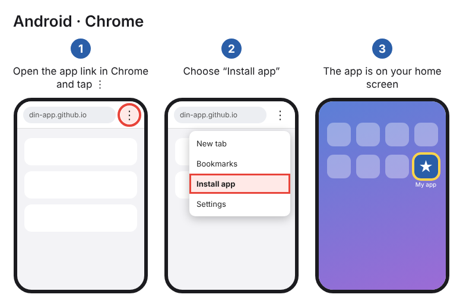
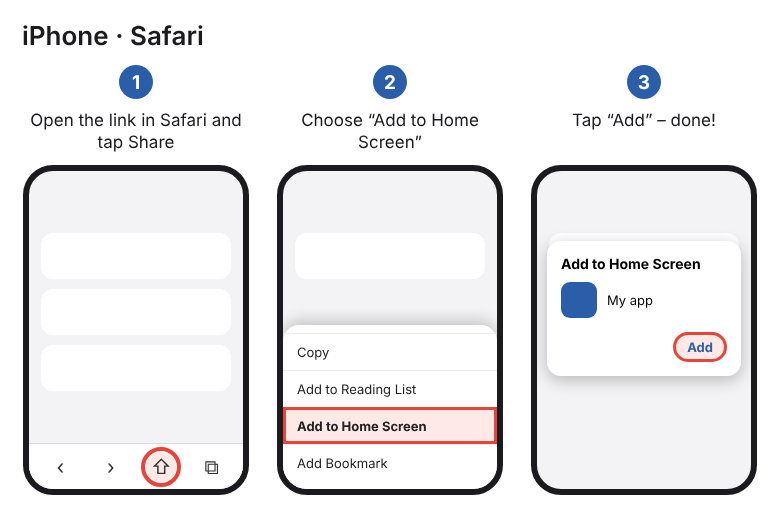

# Task buddy – how to use the app

Help in the app (Settings → Help and manual) is built from this file with `tools/build-help.ps1` when English is chosen. Edit only here (Swedish: `MANUAL.md`).

## Get started
- What spins in your head takes energy. Write it down as a thread with the next step – then you can let go of the thought, the app keeps track of it.
- Tap a thread in the list to show it. There you can tick off steps and write a note right away. Everything else (title, type, fields, dates, delete, archive) you change after tapping ✎ Edit. The arrow ▾ on the right opens a summary (filled-in fields, steps, latest notes) without opening the thread.
- Tap + New thread, write a title (e.g. Sore knee) and choose a type. The type's fields appear right below – fill in what you know and tap Create thread. The thread is saved as open in the list. The rest you can fill in later.

## Why your data is safe here
- This app holds your children's names, your health, your worries, benefit claims and who in the family does what. That should not end up with a company, an advertiser or a hacker.
- **No server to hack.** Most big leaks happen when a company's database with millions of users' data is hacked. There is no such database here: your data is only in your phone. Anyone who wants it has to get into your particular phone.
- **Nothing to sell.** Many free apps – and paid ones too – make money from your data or share it with partners for ads and analytics. This app has no account, no analytics, no ads and no trackers. The browser also technically blocks every request out, so the data cannot be sent anywhere, not even by mistake.
- **Locked backup.** The backup file is encrypted with AES-256 and your password. If you put it in the cloud, the cloud service only sees unreadable data.
- **Open code.** All the code is public on GitHub and can be reviewed by anyone.
- **Honestly: nothing is 100 % safe.** What remains is your own phone – lock it with a code and keep it updated – a weak backup password, and that the app's code on GitHub Pages is not changed by someone unauthorised. But for this kind of data there is no safer practical way than never letting it leave the phone.

## Threads
- Each type has fields in a logical order. Symptom: what, when it started, whether you contacted healthcare, when you called, the appointment you got, the outcome and a final comment.
- Extra fields: tap "+ Extra field" below the fields to add fields that apply only to that thread (e.g. Price), without changing the type. To keep them permanently: tap "+ Save as new type" – a new type opens with the type's fields plus the extra ones, and when you save, the thread moves over to it.
- Wrong type? Change it in the list at the top of the thread. All types switched on in Settings are there. Values follow to fields with the same name. Fields that do not fit can be kept as extra fields or removed. Extra fields move into the fields if you change to a type that has them.
- Everything is saved as soon as you leave a field.
- You tick off steps – today's date is then saved as the done date and shown next to the step; tap the date to change it. If a step has no date: tap 📅 to add one.
- Recurring steps, e.g. Change to winter tyres in the thread Car: tap ↻ next to the step to choose every month (↻ mo) or every year (↻ yr). When you tick it off it stays as done, with a date, and a new identical step is added right below with the date moved a month or a year forward (from the step's date, otherwise from today). If you untick it again the new one is removed. A step can have a date (when you add it or afterwards); unticked steps with a date show in Coming up and Upcoming in Overview, in red if the date has passed. Many types add suggested steps, e.g. Call the health centre.
- Log: write a short note, e.g. Called, got an appointment 18/11. The date is today, but you can choose an earlier date if you write something in afterwards – the note then ends up in the right place in the log. Up to 50 notes per thread.
- The colour shows the category: pink Health, green Finances, blue Home, orange Work, purple Relations, grey Other. Filter with the buttons at the top.
- Select several: hold your finger on a thread until it is selected. Tap more threads to select them, or All for the whole list with the filter you have chosen. Archive or Delete applies to all selected at once, and Undo is available right afterwards. Deleted threads end up in the trash. ✕ or Back ends. In Archive it works the same way, with Reopen and Delete.
- Filter with **👤** (who) and **category**, sort with **↕**: tap to unfold **Date** (the type's end date, shown in brackets after the type name under Settings → Types, e.g. New home (Apply by / Viewing) – the first one filled in is used; if none, the nearest deadline or sub-goal). Sorted by Date each row shows the date (📅), threads without a date go last, Changed (Closed in Archive), Created and Title. A menu opens below the button. Tap a column to sort by it, and again to reverse the order; tap the button again or outside to close (↓ descending, ↑ ascending). The choice is saved.

## Close and archive
- Save in the editor takes you back to the view of the thread, and ✕ there to the list. When the thread is solved: tap Solved – archive. It moves to Archive and stays there. In Archive you can filter by category and search the title. The archive shows 100 threads at a time – Show more at the bottom. Undo is available right afterwards.
- Does something come back, like car tax or a service every year? Choose Repeat: Every month or Every year in the thread. When you archive it a new open thread is created with the same fields and steps, where all dates are moved a month or a year forward. Ticks and steps are reset, the log does not come along. Undo removes the new one too, and so does Reopen as long as you have not started using the new one.
- In Archive you can search and reopen a thread.
- To keep a thread: archive it. To get rid of it: Remove. It then ends up in the Trash (Undo is also available right afterwards).
- The trash is under Settings → Trash → Show the trash. There you can filter by category, open a thread to see its contents, restore it (it goes back where it was, open or in Archive) or delete it for good.
- Under Settings → Trash you also choose how long threads stay before they are deleted automatically (7, 30, 90 days, 1 year or Never; default 30 days), and there you find Empty the trash.
- Clear the archive (Settings → Trash): move archived threads closed more than 1, 2, 5 or 10 years ago to the trash.
- The archive and the trash are stored compressed, so there is room for around 10,000 archived threads (at most 500 open). If storage is almost full the app tells you.
- When the app starts, open threads show right away; the archive loads shortly after. Meanwhile Archive says Loading the archive…, and backup, import and the trash wait until it is done.
- A log line is removed after a question, with Undo afterwards.

## Overview
- Number of open threads per category, steps left and how many you closed in the last 30 days. Everything can be tapped: open threads and a category show the list (filtered), closed shows Archive.
- Coming up (at the top, red number on the tab too): dates in open threads within the reminder period (default 7 days, changed in Settings → Reminders) and deadlines that have passed. What is overdue, today or tomorrow comes first under Urgent, in red; the rest under Soon. Tap a line to open the thread.
- Upcoming: dates further ahead, split into Next week and Within a month.
- Tap "steps left" to see all steps left, with the thread they belong to. Steps with a date come first. Tick off right in the list (with Undo), or tap a step to open the thread.
- Deadline: in Settings → Types each date field can be ticked as a deadline (e.g. Done by, Due). It then shows in Coming up even when the date has passed, until the thread is closed.

## Types and categories
- Settings → Threads → Types: tick more types, e.g. New home, Dental care, Worry or thought, Authority, Insurance, Car and garage, Studies and Call to make.
- Under Settings → Types → a type: tick **End date** on the date fields to use when threads are sorted by Date (in the order you tick them).
- Fewer types (2026-11-18): **Care** (care or dental), **Fix** (home or car), **Case** and **Thoughts and talks** first ask what it is about – the fields follow the choice. New thread shows the six types you use most, the rest under **More types**.
- An open thread is shown in **read mode**: compact, one row per field. Everything is changed under **✎ Edit**: fields, sub-goals, notes and more.
- **New home**: first choose **Buy or rent**. Buy shows price, bank, mortgage approval and bid; Rent shows rent, housing queue, application, apply by and move-in. **Apply by** has both date and time and shows in the reminders.
- Edit a note: tap **✎ Edit** and type straight into it. ✕ deletes it.
- Long notes in the Log are folded to their first line – tap to read all of it. Pasted text is tidied: several empty lines in a row become one, and empty lines at the start and end are removed.
- + Own type: give it a name, icon (emoji) and category and add fields. Kinds: text, long text, date, date and time, number, checkbox, choice from list and days – e.g. House with Address, Price, Viewing, Talked to the bank ✓ and Mortgage approval ✓.
- Suggested steps (one per line, at the bottom of the type) are added to each new thread of the type. In New thread the suggestions show below the fields, and you can untick the ones you do not need. The list of types shows how many steps each type has.
- If you remove a field (or change its kind) filled-in values move to Extra fields in the threads of the type – nothing disappears.
- Categories: change name and colour, or add new ones.

## Shopping (shopping lists)
- The type Shopping list (category Shopping) is a shopping list: create e.g. the thread Weekly shop and add the items as steps.
- Type several items at once, separated by commas: milk, bread, eggs gives three rows.
- Tick them off in the shop. Ticked items move to the bottom, so what is left stays on top.
- A shopping list repeats every week. When you archive it, a new one is made with the same items, all unticked, and Buy by moves one week. Change Repeat under Edit if you do not want that.
- Steps can also repeat every week: tap ↻ until it says ↻ wk.

## Social Insurance Agency (care of sick child, parental benefit)
- The type Social Insurance Agency (Försäkringskassan, Sweden) is for benefits from the Swedish social insurance. What you choose in a list: care of sick child (VAB), parental benefit, sickness benefit, sickness compensation, activity compensation and more. If what you are looking for is missing: choose + Own choice… at the bottom and type it. It is then added to the list. The list can also be changed under Settings → Types → Social Insurance Agency.
- The type has the field Days. Add each day you were home with a sick child or on parental leave: choose the date, write how many hours you managed to work (e.g. 2, 2.5 or 1:30, empty = none) and tap +.
- The app calculates how many hours you were away: a normal working day minus what you worked. Normal working day = the person's working hours per week divided by 5 (40 h/week = 8 h/day, 30 h/week = 6 h/day). Set h/week per person under Settings → Threads → People, and choose Who does it in the thread. Without a person 40 h/week is used.
- Children: if you have added children under People (Relation Child) you choose which child the day is for when you add it. The app suggests the same child as the previous day, or the only child. Change the child under Edit.
- Who stayed home: if you have added more than one adult under People (e.g. you and your partner) you choose who the day is for. Then all care of sick child can be in the same thread. Empty = the thread's person. Hours are counted from that person's working hours, and the same date can appear once per person. Change the person under Edit.
- Tick off each day when you have applied. The list shows e.g. 1/2 applied for, so you see what is left. Worked hours and removing a day you do under Edit.

## People
- Settings → Threads → People: add those who can carry out a thread, e.g. yourself, a partner or a tradesperson. Rename directly in the list; ✕ removes the person (with Undo) and they are then removed from all threads.
- Choose Who does it when you create a thread (below the type's heading) or in the editor. The person shows in the list (👤) and at the top of the thread. A recurring thread keeps the person.
- When any thread has a person, a list 👤 Everyone shows first among the filter buttons in Threads and Archive. Choose a person, or None for threads without a person. It can be combined with the category filter.
- Each person is a box with an initial, a name and a short summary (e.g. Child · 5 years or 30 h/wk). Tap to see and change name, working hours and all properties. Everything is saved right away.
- Properties (at the bottom under People) apply to all people: to start with Relation, Born, Phone, Email, Employer or school and Note. Rename and change kind, move up, change the choices for Relation, or add your own – e.g. Allergies (text), Shoe size (number) or Has passport (checkbox). If you remove a property its value is removed for everyone, with Undo.
- Working hours per week (default 40) are used for hours away in Social Insurance Agency. They are not shown for someone with Relation Child.

## Back
- Back closes what is open (the editor, a thread, the type picker, a type, the step list or a dialog) and then goes back through the tabs you have visited. The app closes only where you started.
- Swipe left or right in Threads to change filter (All, Health, Home …). Not when a thread or a form is open.

## Language
- The app starts in Swedish. Change the language under Settings → General → Language. Your data is the same in both languages; what you write yourself is not translated.

## Backup and moving
- Under Settings → General → Data: tap Save backup file. The file is always encrypted with a password – your code, which the app creates for you.
- To restore: tap Restore backup file, check the summary and tap Replace. All current data is replaced – Undo is available right afterwards.
- The app reminds you to back up every month (change under Data).
- Under Data you see how much storage the app uses. If it gets close to the limit (about 5 MB): save a backup file and delete old threads.
- The backup file is always locked with **your code**: 16 random characters the app creates for you the first time it starts and stores on the device. If you would rather use your own code (e.g. the same in all your apps), tap **Choose your own code** – it needs at least 16 characters with upper and lower case, a digit and a special character, the same requirements as the created one. A backup takes one tap. Under Settings → Data you find Your code: **Show**, **Copy** and **New code**. Save the code in your password manager – on a new phone (or after Delete all data) you need it to open a backup. If you restore a backup with a different code, that code is used for new backups from then on. New code means old backup files open only with the old code (Undo is available). The app collects no data – the code is just a key that protects your backups.

## Install as an app

- **Android (Chrome):** open the app link, tap ⋮ at the top right and choose **Install app**.

- **iPhone (Safari):** open the link in Safari, tap **Share** (the box with the arrow) and choose **Add to Home Screen** → **Add**.
- Installed, the app works like a normal app, even offline.

## Privacy
- The app makes no requests – no server, no analytics, no account. Everything you write is only on this phone.
