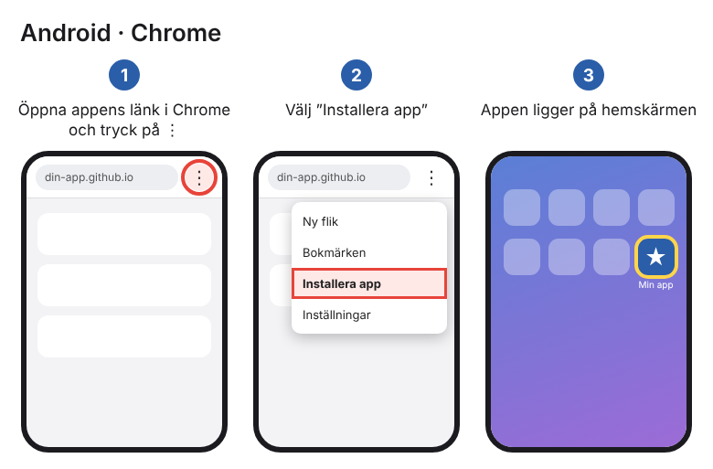
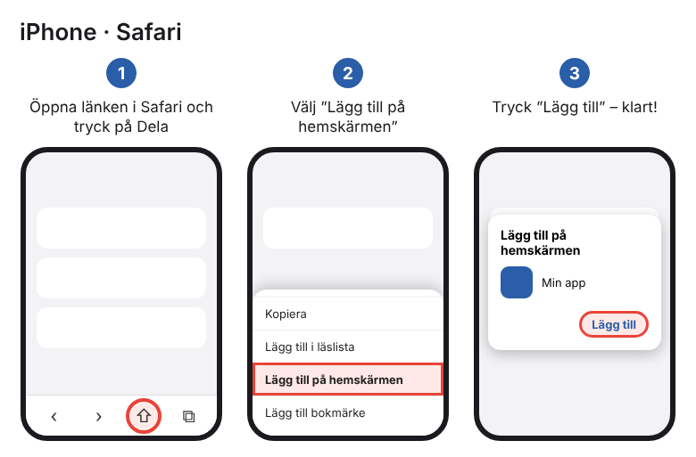

# Task buddy – så använder du appen

Hjälp i appen (Inställningar → Hjälp och manual) byggs från den här filen med `tools/build-help.ps1`. Ändra bara här.

## Kom igång
- Det som snurrar i huvudet tar energi. Skriv ner det som en tråd med nästa steg – då kan du släppa tanken, appen håller reda på den.
- Tryck på en tråd i listan för att visa den. Där kan du bocka av delmål och skriva en anteckning direkt. Allt annat (rubrik, typ, fält, datum, ta bort, arkivera) ändrar du efter att ha tryckt ✎ Redigera. Pilen ▾ till höger fäller ut en sammanfattning (ifyllda fält, delmål, senaste anteckningar) utan att öppna tråden.
- Tryck + Ny tråd, skriv en rubrik (t.ex. Ont i knät) och välj typ. Typens fält visas direkt under – fyll i det du vet och tryck Skapa tråd. Tråden sparas som öppen i listan. Resten kan du fylla i senare.

## Varför din data är säker här
- Här finns barnens namn, din hälsa, din oro, ärenden hos Försäkringskassan och vem i familjen som gör vad. Sådant ska inte hamna hos ett företag, en annonsör eller en hackare.
- **Ingen server att hacka.** De flesta stora läckor sker när ett företags databas med miljontals användares uppgifter hackas. Här finns ingen sådan databas: din data finns bara i din telefon. Den som vill åt den måste komma åt just din telefon.
- **Inget att sälja.** Många gratisappar – och även betalappar – tjänar pengar på din data eller delar den med partner för annonser och analys. Den här appen har inget konto, ingen analys, ingen reklam och inga spårare. Webbläsaren spärrar dessutom tekniskt alla anrop ut, så datan kan inte skickas iväg ens av misstag.
- **Låst backup.** Backup-filen krypteras med AES-256 och ditt lösenord. Lägger du den i molnet ser molntjänsten bara obegriplig data.
- **Öppen kod.** All kod ligger öppet på GitHub och kan granskas av vem som helst.
- **Ärligt: inget är 100 % säkert.** Det som återstår är din egen telefon – lås den med kod och håll den uppdaterad – ett svagt backup-lösenord, och att appens kod på GitHub Pages inte ändras av någon obehörig. Men för den här sortens uppgifter finns inget säkrare praktiskt sätt än att de aldrig lämnar telefonen.

## Trådar
- Varje typ har fält i en logisk ordning. Symptom: vad, när det började, om du kontaktat vården, när du ringde, tiden du fick, utfallet och en slutkommentar.
- Extra fält: tryck på "+ Extra fält" under fälten för att lägga till fält som bara gäller den tråden (t.ex. Pris), utan att ändra typen. Vill du ha dem permanent: tryck "+ Spara som ny typ" – en ny typ öppnas med typens fält plus de extra, och när du sparar flyttar tråden över till den.
- Fel typ? Byt den i listan överst i tråden. Alla typer som är påslagna i Inställningar finns med. Värden följer med till fält med samma namn. Fält som inte passar kan du behålla som extra fält eller ta bort. Extra fält flyttas in i fälten om du byter till en typ som har dem.
- Allt sparas direkt när du lämnar ett fält.
- Delmål bockar du av – dagens datum sparas då som klart-datum och syns bredvid delmålet; tryck på datumet för att ändra det. Har ett delmål inget datum: tryck på 📅 för att lägga till ett.
- Återkommande delmål, t.ex. Byt till vinterdäck i tråden Bilen: tryck på ↻ bredvid delmålet för att välja varje månad (↻ mån) eller varje år (↻ år). När du bockar av det blir det kvar som gjort, med datum, och ett nytt likadant delmål läggs in direkt under med datumet flyttat en månad eller ett år framåt (från delmålets datum, annars från idag). Bockar du ur igen tas det nya bort. Ett delmål kan få ett datum (när du lägger till det eller i efterhand); ej avbockade delmål med datum syns i Aktuellt och Kommande i Överblick, i rött om datumet passerat. Många typer lägger in förslag på delmål, t.ex. Ring vårdcentralen.
- Logg: skriv en kort anteckning, t.ex. Ringde, fick tid 18/11. Datumet är idag, men du kan välja ett tidigare datum om du skriver in något i efterhand – anteckningen hamnar då på rätt plats i loggen. Upp till 50 anteckningar per tråd.
- Färgen visar kategorin: rosa Hälsa, grön Ekonomi, blå Hem, orange Jobb, lila Relationer, grå Övrigt. Filtrera med knapparna överst.
- Markera flera: håll fingret på en tråd tills den blir markerad. Tryck på fler trådar för att markera dem, eller Alla för hela listan med det filter du har valt. Arkivera eller Radera gäller alla markerade på en gång, och Ångra finns direkt efteråt. Raderade trådar hamnar i papperskorgen. ✕ eller Bakåt avslutar. I Arkiv fungerar det likadant, med Öppna igen och Radera.
- Filtrera med **👤** (vem) och **kategori**, sortera med **↕**: tryck för att fälla ut **Datum** (typens slutdatum, som står inom parentes efter typens namn under Inställningar → Typer, t.ex. Ny bostad (Ansök senast / Visning) – det första som är ifyllt används; finns inget, närmaste deadline eller delmål). Sorterat på Datum visar varje rad datumet (📅), trådar utan datum hamnar sist, Ändrad (i Arkiv Stängd), Skapad och Rubrik. En meny fälls ut under knappen. Tryck på en kolumn för att sortera på den, och igen för att vända ordningen; tryck på knappen igen eller utanför för att stänga (↓ fallande, ↑ stigande). Valet sparas.

## Stänga och arkivera
- Spara i redigeringen tar dig tillbaka till visningen av tråden, och ✕ där till listan. När tråden är löst: tryck Löst – arkivera. Den flyttas till Arkiv och finns kvar där. I Arkiv kan du filtrera per kategori och söka i rubriken. Arkivet visar 100 trådar åt gången – Visa fler längst ner. Ångra finns direkt efteråt.
- Återkommer något, som bilskatt eller service varje år? Välj Upprepa: Varje månad eller Varje år i tråden. När du arkiverar den skapas en ny öppen tråd med samma fält och delmål, där alla datum flyttats fram en månad eller ett år. Bockar och delmål nollställs, loggen följer inte med. Ångra tar bort den nya också, och det gör även Öppna igen så länge du inte börjat använda den nya.
- I Arkiv kan du söka och öppna en tråd igen.
- Vill du spara en tråd: arkivera den. Vill du bli av med den: Ta bort. Då hamnar den i Papperskorgen (Ångra finns också direkt efteråt).
- Papperskorgen finns under Inställningar → Papperskorg → Visa papperskorgen. Där kan du filtrera per kategori, fälla ut en tråd för att se innehållet, återställa den (den hamnar där den var, öppen eller i Arkiv) eller radera den för gott.
- Under Inställningar → Papperskorg väljer du också hur länge trådar ligger kvar innan de raderas automatiskt (7, 30, 90 dagar, 1 år eller Aldrig; standard 30 dagar), och där finns Töm papperskorgen.
- Rensa arkivet (Inställningar → Papperskorg): flytta arkiverade trådar som stängdes för mer än 1, 2, 5 eller 10 år sedan till papperskorgen.
- Arkivet och papperskorgen sparas komprimerade, så det ryms runt 10 000 arkiverade trådar (högst 500 öppna). Blir lagringen nästan full säger appen till.
- När appen startar visas öppna trådar direkt; arkivet läses in strax efter. Under tiden står det Läser in arkivet… i Arkiv, och backup, import och papperskorgen väntar tills det är klart.
- En loggrad tas bort efter en fråga, med Ångra efteråt.

## Överblick
- Antal öppna trådar per kategori, delmål som är kvar och hur många du stängt de senaste 30 dagarna. Allt går att trycka på: öppna trådar och en kategori visar listan (filtrerad), stängda visar Arkiv.
- Aktuellt (överst, röd siffra även på fliken): datum i öppna trådar inom påminnelsetiden (standard 7 dagar, ändras i Inställningar → Påminnelser) och deadlines som passerat. Det som är försenat, idag eller imorgon står först under Akut, i rött; resten under Snart. Tryck på en rad för att öppna tråden.
- Kommande: datum längre fram, uppdelat på Nästa vecka och Inom en månad.
- Tryck på "delmål kvar" för att se alla delmål som är kvar, med tråden de hör till. Delmål med datum står först. Bocka av direkt i listan (med Ångra), eller tryck på ett delmål för att öppna tråden.
- Deadline: i Inställningar → Typer kan varje datumfält bockas som deadline (t.ex. Klart senast, Förfaller). Då syns det i Aktuellt även när datumet passerat, tills tråden stängs.

## Typer och kategorier
- Inställningar → Trådar → Typer: bocka i fler typer, t.ex. Ny bostad, Ärende (myndighet eller försäkringsbolag), Studier och Tankar och samtal.
- Under Inställningar → Typer → en typ: bocka i **Slutdatum** på de datumfält som ska användas när trådar sorteras på Datum (i den ordning du bockar).
- Färre typer (2026-11-18): **Vård** (vård eller tandvård), **Fixa** (hemma eller bil), **Ärende** och **Tankar och samtal** väljer först vad det gäller – fälten följer valet. Ny tråd visar de sex typer du använder mest, resten under **Fler typer**.
- En öppen tråd visas i **läsläge**: kompakt, med fälten på en rad var. Allt ändras under **✎ Redigera**: fält, delmål, anteckningar och mer.
- **Ny bostad**: välj först **Köpa eller hyra**. Köpa visar pris, bank, lånelöfte och bud; Hyra visar hyra, bostadskö, intresseanmälan skickad, ansök senast och inflyttning. **Ansök senast** har både datum och klockslag och syns i påminnelserna tills du bockar i **Ansökt**. På samma sätt försvinner Förfaller när du bockar i Betalt, och Klart senast (Reparation) när du bockar i Klar. Datum för sådant du redan har gjort (t.ex. Intresseanmälan skickad, Sökt, Skickat) visas inte i Aktuellt.
- Ändra en anteckning: tryck **✎ Redigera** och skriv direkt i den. ✕ tar bort den.
- Långa anteckningar i Loggen visas hopfällda till första raden – tryck för att läsa hela. Inklistrad text städas: flera tomma rader i rad blir en, och tomma rader först och sist tas bort.
- + Egen typ: ge den namn, ikon (emoji) och kategori och lägg till fält. Sorter: text, lång text, datum, datum och tid, tal, bock, val i lista och dagar – t.ex. Hus med Adress, Pris, Visning, Pratat med banken ✓ och Lånelöfte ✓.
- Förslag på delmål (ett per rad, längst ner i typen) läggs in i varje ny tråd av typen. I Ny tråd syns förslagen under fälten, och du kan bocka ur dem du inte behöver. Listan över typer visar hur många delmål varje typ har.
- Tar du bort ett fält (eller byter dess sort) flyttas ifyllda värden till Extra fält i trådarna av typen – inget försvinner.
- Kategorier: byt namn och färg, eller lägg till nya.

## Handla (inköpslistor)
- Typen Inköp (kategorin Handla) är en inköpslista: skapa t.ex. tråden Veckohandling och lägg in varorna som delmål.
- Skriv flera varor på en gång, skilda med komma: mjölk, bröd, ägg ger tre rader.
- Bocka av i butiken. Avbockade varor flyttas längst ner, så det som är kvar står överst.
- En inköpslista upprepas varje vecka. När du arkiverar den skapas en ny med samma varor, alla obockade, och Handla senast flyttas en vecka. Ändra Upprepa under Redigera om du inte vill det.
- Delmål kan också upprepas varje vecka: tryck ↻ tills det står ↻ v.

## Försäkringskassan (VAB, föräldrapenning)
- Vad väljer du i en lista: VAB (tillfällig föräldrapenning), föräldrapenning, sjukpenning, sjukersättning, aktivitetsersättning, rehabiliteringspenning, graviditetspenning, närståendepenning med flera. Saknas det du söker: välj + Eget val… längst ner och skriv det. Det läggs då till i listan. Listan ändras också under Inställningar → Typer → Försäkringskassan.
- Typen Försäkringskassan har fältet Dagar. Lägg till varje dag du vabbat eller varit föräldraledig: välj datum, skriv hur många timmar du hann jobba (t.ex. 2, 2,5 eller 1:30, tomt = inget) och tryck +.
- Appen räknar ut hur många timmar du var borta: normal arbetsdag minus det du jobbade. Normal arbetsdag = personens arbetstid per vecka delat med 5 (40 tim/vecka = 8 tim/dag, 30 tim/vecka = 6 tim/dag). Ställ in tim/v per person under Inställningar → Trådar → Personer, och välj Vem utför i tråden. Utan person räknas 40 tim/vecka.
- Barn: har du lagt till barn under Personer (Relation Barn) väljer du vilket barn dagen gäller när du lägger till den. Appen föreslår samma barn som förra dagen, eller det enda barnet. Byt barn under Redigera.
- Vem var hemma: har du lagt till fler än en vuxen under Personer (t.ex. dig och din partner) väljer du vem dagen gäller. Då kan ni ha all VAB i samma tråd. Tomt = trådens person. Timmarna räknas från den personens arbetstid, och samma datum kan finnas en gång per person. Byt person under Redigera.
- Bocka av varje dag när du har ansökt. Listan visar t.ex. 1/2 ansökta, så du ser vad som är kvar. Arbetade timmar och ta bort en dag gör du under Redigera.

## Personer
- Inställningar → Trådar → Personer: lägg till de som kan utföra en tråd, t.ex. du själv, en partner eller en hantverkare. Byt namn direkt i listan; ✕ tar bort personen (med Ångra) och den tas då bort från alla trådar.
- Välj Vem utför när du skapar en tråd (under typens rubrik) eller i redigeringen. Personen syns i listan (👤) och överst i tråden. En återkommande tråd behåller personen.
- När någon tråd har en person visas en lista 👤 Alla först bland filterknapparna i Trådar och Arkiv. Välj en person, eller Ingen för trådar utan person. Den går att kombinera med kategorifiltret.
- Varje person är en ruta med initial, namn och en kort sammanfattning (t.ex. Barn · 5 år eller 30 tim/v). Tryck för att se och ändra namn, arbetstid och alla egenskaper. Allt sparas direkt.
- Egenskaper (längst ner under Personer) gäller alla personer: från början Relation, Född, Telefon, E-post, Arbetsgivare eller skola och Anteckning. Byt namn och sort, flytta upp, ändra valen för Relation, eller lägg till egna – t.ex. Allergier (text), Skostorlek (tal) eller Har pass (bock). Tar du bort en egenskap tas värdet bort hos alla, med Ångra.
- Arbetstiden per vecka (standard 40) används för timmar borta i Försäkringskassan. Den visas inte för den som har Relation Barn.

## Bakåt
- Bakåt stänger det som är öppet (redigeringen, en tråd, typväljaren, en typ, delmålslistan eller en dialog) och går sedan tillbaka genom flikarna du besökt. Appen stängs först där du började.
- Svep åt vänster eller höger i Trådar för att byta filter (Alla, Hälsa, Hem …). Inte när en tråd eller ett formulär är öppet.

## Språk
- Appen är på svenska från början. Byt språk under Inställningar → Allmänt → Språk. Din data är densamma på båda språken; det du själv skriver översätts inte.

## Backup och flytt
- Under Inställningar → Allmänt → Data: tryck Spara backup-fil. Filen krypteras alltid med ett lösenord – din kod, som appen skapar åt dig.
- För att läsa tillbaka: tryck Läs in backup-fil, kontrollera sammanfattningen och tryck Ersätt. All nuvarande data ersätts – Ångra finns direkt efteråt.
- Appen påminner om backup varje månad (ändra under Data).
- Under Data ser du hur mycket lagring appen använder. Närmar den sig gränsen (cirka 5 MB): spara en backup-fil och ta bort gamla trådar.

- Backup-filen låses alltid med **din kod**: 16 slumpade tecken som appen skapar åt dig första gången den startas och sparar på enheten. Vill du hellre använda en egen kod (t.ex. samma i alla dina appar) trycker du **Välj egen kod** – den måste ha minst 16 tecken med stor och liten bokstav, siffra och specialtecken, samma krav som den skapade. Backup sparas med ett tryck. Under Inställningar → Data finns Din kod: **Visa**, **Kopiera** och **Ny kod**. Spara koden i din lösenordshanterare – på en ny telefon (eller efter Radera all data) behöver du den för att öppna en backup. Läser du in en backup med en annan kod används den koden sedan för nya backuper. Ny kod gör att gamla backup-filer bara öppnas med den gamla koden (Ångra finns). Appen samlar ingen data – koden är bara en nyckel som skyddar dina backuper.
## Installera som app

- **Android (Chrome):** öppna appens länk, tryck ⋮ uppe till höger och välj **Installera app**.

- **iPhone (Safari):** öppna länken i Safari, tryck **Dela** (rutan med pilen) och välj **Lägg till på hemskärmen** → **Lägg till**.
- Installerad fungerar appen som en vanlig app, även utan nät.

## Integritet
- Appen gör inga anrop – ingen server, ingen analys, inget konto. Allt du skriver finns bara i den här telefonen.
